<div align="center">



# 👑 CAPİTİS — Creator Media Kit & Collaboration Platform
### *“Zihin setini sıradanlıktan kurtar. Hayatını yeniden inşa et.”*

[](https://erocores.github.io/capitis-media-kit/)
[](https://github.com/EroCores/capitis-media-kit)
[](https://nextjs.org/)
[](https://react.dev/)
[](https://tailwindcss.com/)
[](https://threejs.org/)
[](https://www.tiktok.com/@capitis.tr)

<br/>

**[🚀 CANLI SİTEYİ İNCELE](https://erocores.github.io/capitis-media-kit/)** &nbsp;•&nbsp; **[📄 MEDYA KİTİ (PDF)](https://erocores.github.io/capitis-media-kit/capitis-media-kit.pdf)** &nbsp;•&nbsp; **[✉️ RESMİ E-POSTA](mailto:iletisim.capitis@gmail.com)**

---

</div>

## 🌟 Projeye Genel Bakış

**CAPİTİS** (@capitis.tr), kişisel gelişim, zihniyet (mindset), disiplin ve vizyon alanında Türkiye'nin önde gelen içerik üreticilerinden biridir. Bu web platformu, markaların ve reklamverenlerin CAPİTİS ile sponsorluk, reklam entegrasyonu ve UGC (User Generated Content) ortaklıklarını en üst düzeyde yapılandırabilmesi için **2040 nesil fütüristik arayüz ve interaktif stüdyo konfigüratörü** ile geliştirilmiştir.

---

## 🚀 Öne Çıkan Özellikler

### 🌌 1. Kinetik Jiroskopik 3D Kuantum Çekirdek (Three.js WebGL)
- Çift zıt orbital ekseninde dönen altın ve mor titanyum halkalar.
- Fare konumunu sönümleyerek (damping) takip eden interaktif paralaks tepkisi.
- 120 parçacıklı uzay tozu nebulası ve mikro nabız animasyonu.
- Düşük donanımlı cihazlar veya WebGL desteklemeyen tarayıcılar için otomatik 2D fallback.

### 📱 2. Sinematik 9:16 Akıllı Telefon Video Vitrini
- Dikey iPhone/Titanyum kasa tasarımı ile gerçekçi TikTok arayüzü overlay'i (`❤️ Beğeni`, `💬 Yorum`, `🔖 Kaydet`, `↗️ Paylaş`).
- Orijinal ses dönen vinil diski ve kanca (hook) metinleri.
- Tümü, Disiplin, Motivasyon, Mindset, Başarı, Vizyon ve Kişisel Gelişim filtreleme sekmeleri.

### 🎛️ 3. İnteraktif Stüdyo & Teklif Yapılandırıcı (Canlı Hesaplayıcı)
- 5 farklı iş birliği paketi seçimi.
- Modüler ek hizmetler (Spark Ads Lisansı, 48-72s Ekspres Teslimat, 4K Ham Çekim, Instagram Reels/Story, 3 Alternatif Kanca).
- Seçimlere göre anlık olarak güncellenen **"Tahmini Toplam Yatırım"** ve **"Teslimat Süresi"** hesaplama motoru.
- Tek tıkla **Resmi E-posta İstemcisi** ile brief iletimi veya pano kopyalama.

### 📑 4. Entegre 5 Sayfalık Medya Kiti Görüntüleyici & PDF İndirme
- Sitenin içinden çıkmadan yüksek çözünürlükte slayt olarak incelenebilen interaktif modal.
- Tek tıkla orijinal 5 sayfalık yüksek kaliteli PDF dosyasını cihaza indirme.

---

## 📊 Doğrulanmış TikTok Studio Metrikleri (13 Kasım 2026)

| Metrik | Değer | Kapsam / Detay |
| :--- | :--- | :--- |
| **Video Görüntüleme** | **2,4 Milyon+** | Son 365 gün organik TikTok akışı |
| **Toplam Tekil İzleyici** | **1,8 Milyon** | Hesabın temas ettiği bağımsız karar vericiler |
| **Yeni İzleyici Oranı** | **1,4 Milyon** | Sürekli organik genişleme |
| **Organik Paylaşım** | **11,2 Bin+** | Viral yayılım ve topluluk gücü |
| **Profil Görüntüleme** | **8,7 Bin+** | Biyo link ve marka yönlendirme trafiği |
| **Sizin İçin (For You)** | **%80,1** | Doğrudan algoritmik keşif önerisi |
| **Çekirdek Yaş Kitlesi** | **%80,6** | 18–34 yaş arası kariyer ve başarı odaklı gençler |
| **Cinsiyet Dengesi** | **%69 Erkek / %29 Kadın** | Teknoloji, finans, giyim ve erkek bakım uyumlu |

---

## 💎 İş Birliği Paketleri Karşılaştırma Matrisi

```
┌─────────────────────────┬──────────────┬──────────────┬─────────────────────────┐
│ PAKET ADI               │ VİDEO SAYISI │ YATIRIM      │ ÖNE ÇIKAN AYRICALIKLAR  │
├─────────────────────────┼──────────────┼──────────────┼─────────────────────────┤
│ Mini Paket              │ 1 Video      │ ₺350         │ Düşük bütçeyle ilk test │
│ Başlangıç Paketi ★      │ 2 Video      │ ₺650         │ 2 farklı kurgu (%7 tas) │
│ Avantajlı Paket         │ 3 Video      │ ₺900         │ 3'lü seri kampanya      │
│ VIP Büyüme Serisi 👑    │ 5 Video      │ ₺1.650       │ Spark Ads Lisansı Dahil │
│ 360° Kurumsal / UGC     │ 8+ Video     │ Özel Teklif  │ Tam ticari reklam hakkı │
└─────────────────────────┴──────────────┴──────────────┴─────────────────────────┘
```

---

## 🛠️ Teknoloji Mimarisi

- **Framework:** [Next.js 16 (App Router)](https://nextjs.org/) — Tamamen statik derleme (`output: 'export'`)
- **UI Kütüphanesi:** [React 19](https://react.dev/)
- **Stil & Tasarım Tokenları:** [Tailwind CSS v4](https://tailwindcss.com/) — Obsidian `#050507`, Titanyum ve Lüks Altın `#d4a843`
- **3D Motor:** [Three.js](https://threejs.org/) WebGL Canvas
- **Pürüzsüz Kaydırma:** [Lenis Smooth Scroll](https://lenis.darkroom.engineering/)
- **İkonlar:** [Lucide React](https://lucide.dev/)
- **Şema Doğrulama:** [Zod](https://zod.dev/)
- **Birim Testleri:** [Vitest](https://vitest.dev/)
- **CI/CD & Dağıtım:** GitHub Actions + GitHub Pages

---

## 📂 Dizin Ağacı

```text
capitis-media-kit/
├── .github/
│   └── workflows/
│       └── deploy.yml          # GitHub Pages otomatik derleme ve dağıtım
├── docs/                       # Detaylı güncelleme ve yayınlama rehberleri
├── public/
│   ├── capitis-media-kit.pdf   # Orijinal 5 sayfalık 1.3MB medya kiti
│   ├── favicon.ico             # 32x32 özel logo ikonu
│   ├── icons/                  # PWA ve Apple touch ikonları
│   └── images/                 # Vektörel logo ve sunum sayfası renderları
├── src/
│   ├── app/                    # Next.js rotaları (/privacy, /kvkk, /cookies, /terms)
│   ├── components/
│   │   ├── forms/              # Brief stüdyosu ve canlı hesaplayıcı
│   │   ├── layout/             # Header, Footer
│   │   ├── motion/             # Lenis akıcı kaydırma
│   │   ├── sections/           # Hero, Bento, Kitle, Paketler, Vitrin vb.
│   │   ├── three/              # 2040 Kinetik Kuantum Çekirdek (Three.js)
│   │   └── ui/                 # Logo, Modal, Buton, Rozetler
│   ├── config/                 # Merkezi tekil veri kaynakları (fiyat, metrik vb.)
│   ├── lib/                    # Yardımcı araçlar, format ve doğrulama
│   └── types/                  # TypeScript veri modelleri
└── tests/                      # Vitest birim testleri (7 test)
```

---

## 💻 Geliştirici Kurulumu

```bash
# Depoyu klonlayın
git clone https://github.com/EroCores/capitis-media-kit.git
cd capitis-media-kit

# Bağımlılıkları kurun
npm install

# Geliştirme sunucusunu çalıştırın (http://localhost:3000)
npm run dev

# TypeScript tip kontrolü
npm run typecheck

# Birim testleri çalıştırın
npm run test

# Statik export çıktısı üretin (out/ klasörü)
npm run build
```

---

## 📬 Resmi İletişim

- **İçerik Üreticisi:** CAPİTİS (@capitis.tr)
- **TikTok:** [tiktok.com/@capitis.tr](https://www.tiktok.com/@capitis.tr)
- **Instagram:** [instagram.com/capitis.tr](https://www.instagram.com/capitis.tr/)
- **Kurumsal E-posta:** [iletisim.capitis@gmail.com](mailto:iletisim.capitis@gmail.com)
- **Canlı Web Sitesi:** [erocores.github.io/capitis-media-kit](https://erocores.github.io/capitis-media-kit/)

---

<div align="center">
<sub>© 2026 CAPİTİS. Tüm hakları saklıdır. Bu proje <a href="https://github.com/EroCores">EroCores</a> tarafından gururla geliştirilmiştir.</sub>
</div>
